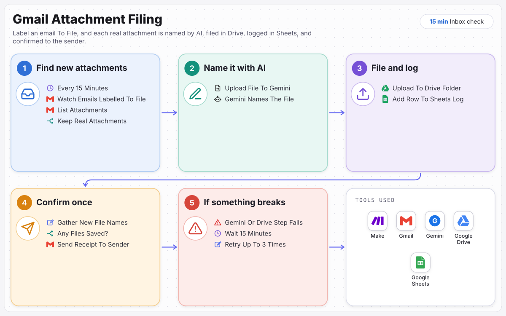

# Gmail Attachment Filing

Label it once. It is named, filed and logged.

> Built for **Fernhill Bookkeeping**, a fictional sample client. The business, people and data are invented; the scenario is complete and runs.

Label a client email To File and every attachment is named by AI, filed in Google Drive, logged in Google Sheets, and confirmed to the sender in one receipt.

**Full case study:** [ramonvallejera.com/case-study/gmail-attachment-filing](https://ramonvallejera.com/case-study/gmail-attachment-filing)

## How it works

1. Find new attachments every 15 minutes
2. Keep real attachments only
3. Name each file with Gemini
4. File it in Drive and log it in Sheets
5. Send the sender one receipt
6. If Gemini or Drive fails: retry up to 3 times, 15 minutes apart

Built a Make scenario that checks Gmail every 15 minutes for emails labelled To File. It keeps only real attachments, has Gemini read each file and give it a short, descriptive name, saves it to the client documents folder in Google Drive, logs it in Google Sheets, and sends the sender one receipt listing every file saved.

## What's in this repo

| File | What it is |
|---|---|
| `blueprint.json` | The Make scenario, 8 modules plus 3 Retry error handlers, ready to import |
| `docs/process-map.svg` | The process map from the case study |

Trigger: `Watch Emails` in Gmail, searching `label:to-file has:attachment`, up to 10 emails per run.

## Set it up

1. In Make, create a scenario, open the **⋯** menu, choose **Import Blueprint** and select `blueprint.json`.
2. Connect these accounts on the modules that need them:

   - Gmail (Google) (3 modules)
   - Google Gemini AI (2 modules)
   - Google Drive (1 module)
   - Google Sheets (1 module)

3. Replace the placeholders with your own:

   - `YOUR_DRIVE_FOLDER_ID` (2×): the client documents folder
   - `YOUR_PARENT_FOLDER_ID` (2×): the folder that holds it
   - `YOUR_GOOGLE_SHEET_ID` (1×): the log sheet, with columns for date, original name, new name, file type and link

4. In Gmail, create the label `To File`. Label a test email that has an attachment, click **Run once**, then schedule the scenario every 15 minutes.

Tools: Make, Gmail, Gemini, Google Drive, Google Sheets.

## Notes

- The scenario is named `Integration Gmail` in the blueprint, as it is in Make.
- Connections and account IDs were removed before publishing. Make asks for a connection on each module after import.
- Built by Ramon Vallejera Jr., AI Automation Specialist.
